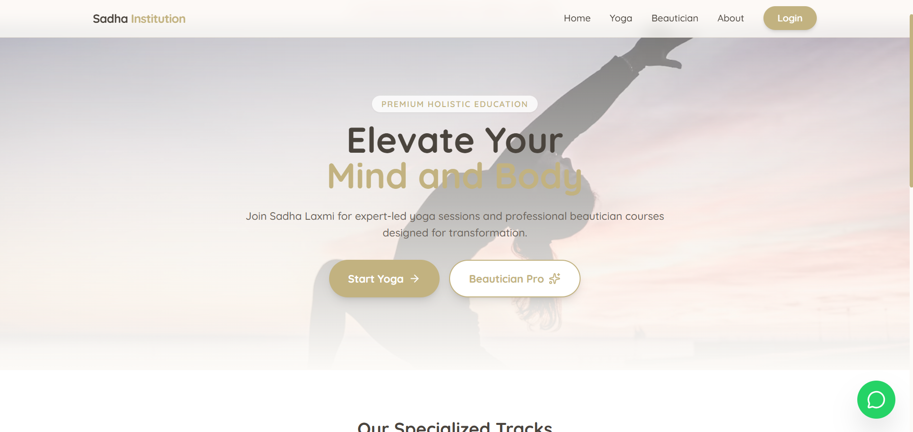
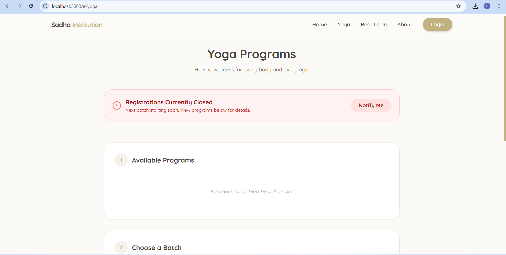
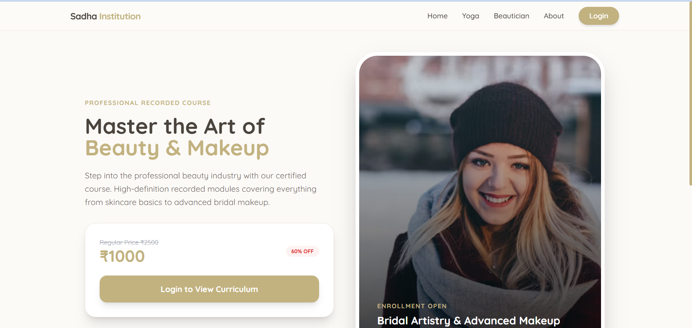
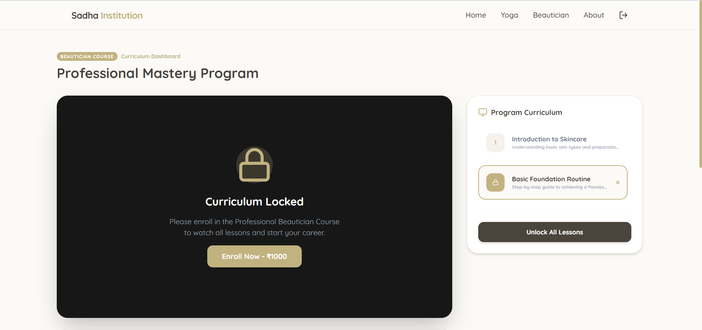
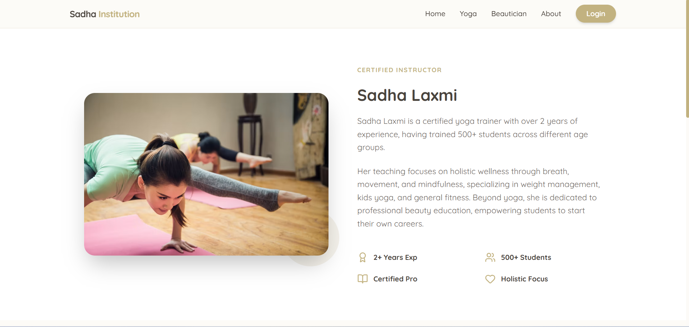
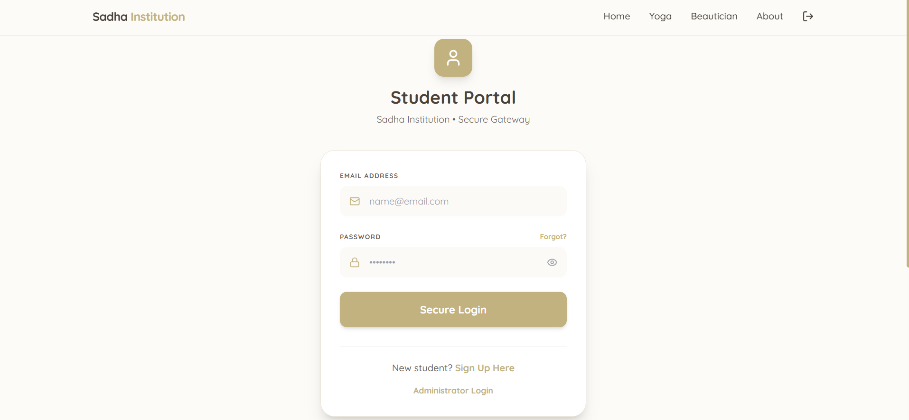

# 🌿 Sadha Institution

A modern and responsive website for **Sadha Institution**, showcasing yoga sessions and beautician courses. This project was built as part of my React and TypeScript learning journey to practice creating a clean, user-friendly, and responsive web application.

## 🚀 Live Demo

🔗 https://sadha-institution.vercel.app/#/

## 💻 GitHub Repository

🔗 https://github.com/MarellaHasmitha/sadha-institution

---

## ✨ Features

- Responsive user interface
- Modern landing page with hero section
- Yoga course information
- Beautician course details
- About page
- Login page
- Registration status notification banner
- WhatsApp contact button
- Clean navigation and responsive layout

---

## 🛠️ Tech Stack

### Frontend
- React
- TypeScript
- Vite
- HTML5
- CSS3

### Tools
- Visual Studio Code
- Git
- GitHub

---

## 📂 Project Structure

```
src/
│
├── components/
│   └── Navbar.tsx
│
├── pages/
│   ├── Home.tsx
│   ├── Yoga.tsx
│   ├── Beautician.tsx
│   ├── About.tsx
│   ├── Login.tsx
│   ├── AdminDashboard.tsx
│   └── Success.tsx
│
├── store/
│   └── InstitutionContext.tsx
│
├── App.tsx
└── main.tsx
```

---

## ⚙️ Getting Started

### Clone the repository

```bash
git clone https://github.com/MarellaHasmitha/sadha-institution.git
```

### Navigate to the project

```bash
cd sadha-institution
```

### Install dependencies

```bash
npm install
```

### Start the development server

```bash
npm run dev
```

The application will be available at:

```
http://localhost:3000
```

---

## 📸 Screenshots

> Add screenshots after deployment.
## 📸 Screenshots

### Home Page



---

### Yoga Page



---

### Beautician Page



---

### Beautician Course Page



---

### About Page



---

### Login Page


---

## 🎯 Learning Objectives

This project helped me practice:

- Building responsive React applications
- Developing with TypeScript
- Component-based architecture
- Managing application state
- Organizing project structure
- Using Git and GitHub for version control

---

## 🚧 Future Enhancements

- Online course registration
- User authentication
- Admin dashboard improvements
- Backend integration
- Database connectivity
- Email notifications
- Student portal

---

## 👩‍💻 Author

**Hasmitha Marella**

- GitHub: https://github.com/MarellaHasmitha
- LinkedIn: https://www.linkedin.com/in/hasmitha-marella-a06650254/

---

## 📄 License

This project is shared for educational and portfolio purposes.
